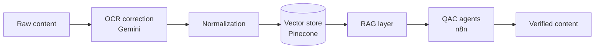

I build LLM-powered systems, retrieval pipelines, and the automation around them, then ship them to real users.

Executive, Content Engineering at [10 Minute School](https://10minuteschool.com) · Dhaka, Bangladesh

---

## What I do

<table>
<tr>
<td width="50%" valign="top">

### RAG and knowledge systems
Owner of the **TenTen Knowledgebase**, a Pinecone-backed retrieval pipeline that cut manual operations effort for the content team.

</td>
<td width="50%" valign="top">

### Multi-agent automation
Content pipelines on **n8n** and **Gemini**, including Bangla OCR correction and QAC agents that verify and normalize academic content.

</td>
</tr>
<tr>
<td width="50%" valign="top">

### Full stack products
**Next.js**, **Node.js**, and **Firebase** apps, plus the internal tools (CMS, dashboards, backend databases) that keep a large platform running.

</td>
<td width="50%" valign="top">

### Applied NLP research
Aspect-based sentiment analysis, text classification, and summarization with transformer models.

</td>
</tr>
</table>

## How the content pipeline fits together

## Selected work

| Project | What it is | Stack |
| :-- | :-- | :-- |
| **Insightful Analysis of Bangladeshi Airlines Reviews** | Aspect-based sentiment classification and Bengali review summarization. Thesis work, being prepared for publication. | BERT, LLMs, Python |
| **Detection to Intervention** | Comparative analysis of machine learning models for suicide prevention. | Python, scikit-learn |
| **SmartBiz Lite** | Independent full stack project. | Next.js, Node.js, Firebase |
| **Workflow automation** | Lightweight business workflow systems. | Google Sheets, Apps Script |

## Tech stack

**Languages**

**Frameworks and platforms**

**AI and automation**

**Exploring next:** analytics engineering with BigQuery and Metabase, and internal tooling for automations and dashboards.

